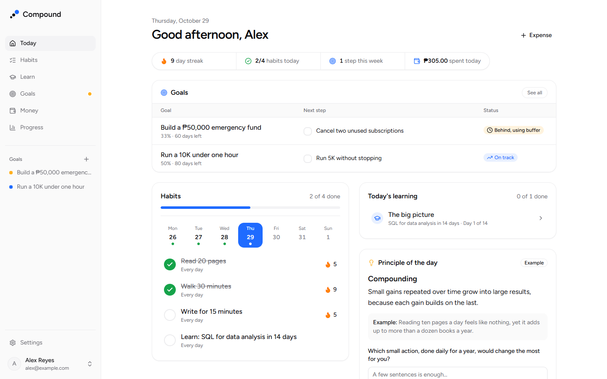
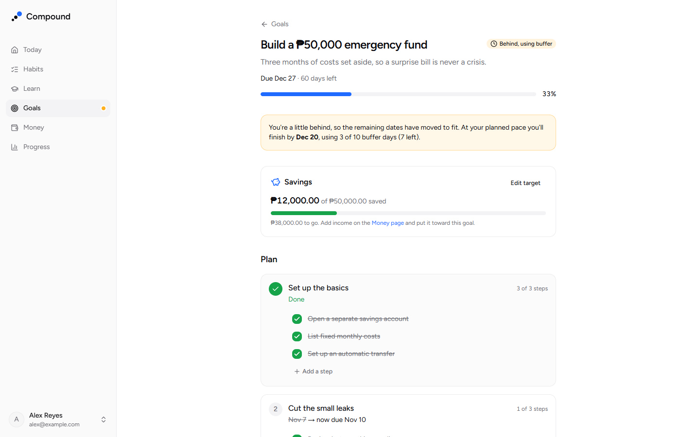
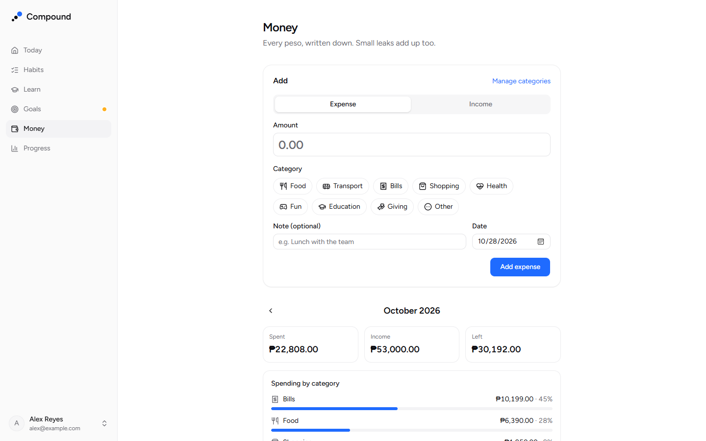
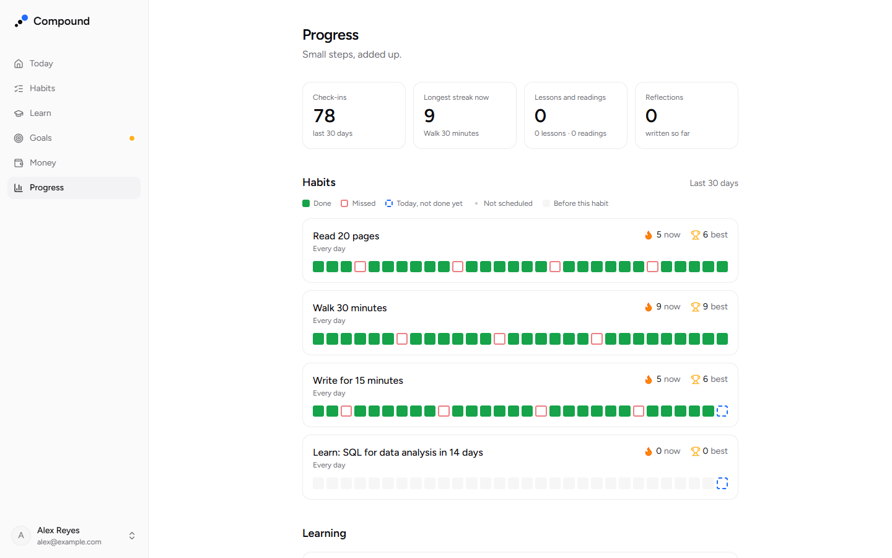
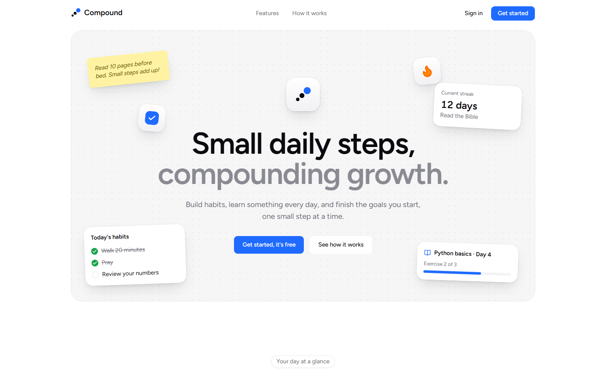
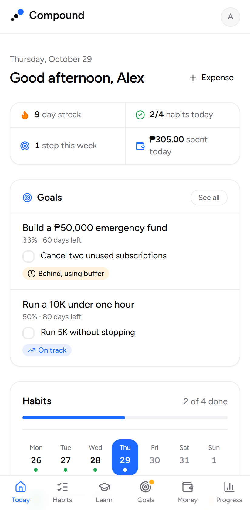
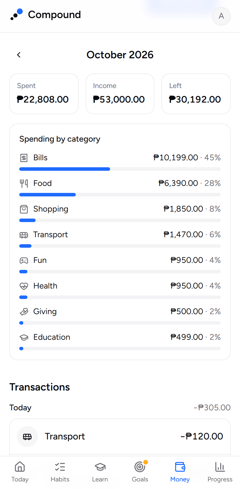

# Compound

**Small daily steps, compounding growth.**

Compound is a web app for getting 1% better every day. You track daily habits, follow short AI-generated learning tracks, break big goals into steps you can take today, and write down every peso you spend.

**Live:** [compound-nine-chi.vercel.app](https://compound-nine-chi.vercel.app)

> This is my portfolio project, built in small, deployable steps.



## Modules

| Module | What it does | Status |
| --- | --- | --- |
| **Learning & Habits** | Daily habits with streaks. AI learning tracks (skills, reading plans, thinking exercises) with lessons, exercises and feedback. A principle of the day. | Done |
| **Goals** | The AI drafts a plan of milestones and steps, which you can edit. Each goal keeps buffer days before its deadline. When you fall behind, the remaining dates move and the status changes from on track to behind or at risk. Goals that need attention get a dot in the nav. | Done |
| **Money** | Record expenses and income in a few taps. Monthly totals, spending by category, and your own categories. Income can go toward a goal's savings target. | Done |

## Screenshots

| A goal that's slipping | Money for the month |
| --- | --- |
|  |  |
| **Progress** | **Landing page** |
|  |  |

<p>
  
  &nbsp;
  
</p>

## Tech stack

- **[Next.js 16](https://nextjs.org)** (App Router, Cache Components, partial prerendering) and **React 19**
- **TypeScript** in strict mode
- **PostgreSQL** on [Neon](https://neon.tech), queried with **[Kysely](https://kysely.dev)** (typed SQL and migrations)
- **[Auth.js](https://authjs.dev)** with Google and GitHub sign-in and JWT sessions
- **[Zod](https://zod.dev)** to validate all form input and AI output
- **[Tailwind CSS 4](https://tailwindcss.com)** and **[shadcn/ui](https://ui.shadcn.com)** on Base UI
- **Claude API**, called from the server only
- **[Vitest](https://vitest.dev)** for unit tests and **[Playwright](https://playwright.dev)** for end-to-end tests
- Deployed on **Vercel**

## How it's built

- **Static shell, dynamic data.** With Cache Components, every page prerenders a static shell. Anything that reads the session sits inside `<Suspense>` and streams in, so pages appear instantly.
- **Auth checks in a data access layer.** `proxy.ts` sends signed-out visitors to `/login`, but the real check lives in [`lib/auth/dal.ts`](compound/lib/auth/dal.ts). Every protected page and server action calls `requireUser()` or `requireOnboardedUser()` before it touches data.
- **Typed database.** The table types are in [`lib/db/types.ts`](compound/lib/db/types.ts), so Kysely catches mistakes in queries at compile time. Constraints such as allowed values and unique check-ins are enforced in Postgres as well.
- **Streaks are calculated, never stored.** They're always derived from the check-in history, so they can't drift out of sync.
- **AI is treated as untrusted input.** Every AI response must be JSON that passes a Zod schema. Generated content is cached so it's never regenerated. Model names come from environment variables, and the AI never writes scripture text.
- **Demo mode.** Without an API key (or with `AI_DEMO_MODE=1`), the app uses clearly labelled example content instead of calling Claude, so it runs end to end for free.
- **Goal schedules are pure functions.** [`lib/goals/schedule.ts`](compound/lib/goals/schedule.ts) works out the status, adjusted dates and buffer use from the plan and the steps you've ticked. Nothing about the schedule is stored, and it's covered by unit tests. The pace comes from the original plan, so extending a deadline really gives you more room.
- **Money in integer cents.** Amounts are parsed and stored as whole cents, never floats, so totals don't pick up rounding errors. They're formatted with `Intl` in the currency you choose in Settings.

## Running it locally

You need **Node.js 20.9 or newer**, a **Neon** database, and a **Google OAuth client** and/or a **GitHub OAuth app**.

### 1. Install

```bash
git clone https://github.com/DanielZyrick/Compound.git
cd Compound/compound
npm install
cp .env.example .env.local
```

### 2. Database

Use a separate Neon branch for development, so local work never touches production data:

1. In the Neon console, create a branch named `dev` from `main`. Set auto-delete to **never**.
2. Click **Connect**, choose the `dev` branch, and copy two connection strings into `.env.local`:
   - the **pooled** one (its host contains `-pooler`) into `DATABASE_URL`
   - the **direct** one into `DATABASE_URL_UNPOOLED`

Don't run `vercel env pull`: it would overwrite `.env.local` with the Vercel project's variables.

### 3. Sign-in

Generate `AUTH_SECRET`:

```bash
node -e "console.log(require('crypto').randomBytes(32).toString('base64'))"
```

**Google.** In the [Google Cloud console](https://console.cloud.google.com/apis/credentials), create an **OAuth client ID** of type *Web application* with these authorized redirect URIs:

- `http://localhost:3000/api/auth/callback/google`
- `https://<your-domain>/api/auth/callback/google`

Put its client ID and secret in `AUTH_GOOGLE_ID` and `AUTH_GOOGLE_SECRET`. One Google client can serve both local and production.

**GitHub.** Create an OAuth app at [github.com/settings/developers](https://github.com/settings/developers) with these settings:

- **Homepage URL:** `http://localhost:3000`
- **Callback URL:** `http://localhost:3000/api/auth/callback/github`

Put its client ID and secret in `AUTH_GITHUB_ID` and `AUTH_GITHUB_SECRET`. Production uses a separate GitHub OAuth app, because a GitHub OAuth app has only one callback URL.

Accounts are matched by email, so Google and GitHub open the same Compound account when they share an address. Sign-in only accepts an address the provider has verified.

### 4. Migrate and run

```bash
npm run db:migrate
npm run dev
```

Open [localhost:3000](http://localhost:3000) and sign in with Google or GitHub.

## Scripts

Run these from the `compound/` folder.

| Command | What it does |
| --- | --- |
| `npm run dev` | Start the dev server |
| `npm run build` / `npm start` | Production build and server |
| `npm test` / `npm run test:watch` | Run the Vitest unit tests |
| `npm run test:e2e` | Build, then run the Playwright end-to-end tests (desktop and phone) |
| `npm run typecheck` | Type-check with `tsc` |
| `npm run lint` | Run ESLint |
| `npm run db:migrate` | Apply pending migrations |
| `npm run db:rollback` | Undo the most recent migration |

`db:migrate` uses `DATABASE_URL_UNPOOLED` from `.env.local`. To migrate a different branch, put that branch's direct connection string in a temporary, gitignored env file and pass it to the runner. Variables from the file take priority over `.env.local`:

```bash
# .env.migrate-main contains: DATABASE_URL_UNPOOLED=<direct connection string>
npx tsx --env-file=.env.migrate-main db/migrate.ts up
rm .env.migrate-main
```

### End-to-end tests

The 16 Playwright tests in `e2e/` sign in as a dedicated test user and walk through onboarding, habits, a lesson, a reading, goals (creating, editing steps, falling behind and catching up), money (adding, editing, categories, saving toward a goal) and settings. Then they delete the test user. Each test runs on desktop and on a phone. They:

- **refuse to run** unless `DATABASE_URL` points at the host in `E2E_DB_HOST`, so they can't touch production;
- force AI **demo mode** (`AI_DEMO_MODE=1`), so they never spend API credits;
- use your installed **Microsoft Edge**, so no browser download is needed.

Running `npm start` locally also needs `AUTH_TRUST_HOST=true`. Vercel sets it automatically, and `npm run dev` doesn't need it.

## Deploying

The app is deployed on Vercel with the **root directory set to `compound`**. Production uses the Neon `main` branch.

When a change includes a new migration:

1. Run the migration against `main`, using the command above.
2. Push to `main`. Vercel builds and deploys it.

Migrations add to the schema before the code that uses it ships. A migration that renames or removes something can break the live site until the new code is deployed, so plan those deploys separately.

## Environment variables

| Variable | Used for |
| --- | --- |
| `DATABASE_URL` | Pooled Postgres connection (the app) |
| `DATABASE_URL_UNPOOLED` | Direct Postgres connection (migrations) |
| `AUTH_SECRET` | Encrypts session cookies |
| `AUTH_GOOGLE_ID`, `AUTH_GOOGLE_SECRET` | Google OAuth client |
| `AUTH_GITHUB_ID`, `AUTH_GITHUB_SECRET` | GitHub OAuth app |
| `ANTHROPIC_API_KEY` | Claude API (server only) |
| `MODEL_FAST`, `MODEL_SMART` | Claude model names: fast for feedback, smart for planning |
| `AI_DEMO_MODE` | Optional. `1` uses example content instead of calling Claude |
| `E2E_DB_HOST` | End-to-end tests only: the dev database host they're allowed to use |

`.env.local` is gitignored. Only `.env.example` is committed, with empty values.

## Project structure

```
docs/screenshots/   images for this README
compound/
  app/
    (app)/          signed-in pages: today, habits, tracks, goals, money, progress, settings
    onboarding/     first-run setup: focus areas, first habits, timezone
    login/          Google and GitHub sign-in, error messages
    page.tsx        landing page (fully static)
  components/
    app-shell/      sidebar, phone tab bar, account menu, nav attention dot
    landing/        landing page sections
    money/          category icons
    ui/             shadcn/ui components
  db/
    migrations/     Kysely migrations, listed in index.ts
    migrate.ts      migration runner (npm run db:migrate)
  e2e/              Playwright tests and their helpers
  lib/
    ai/             Claude client, demo mode, daily limits, call logging
    auth/           data access layer, server actions, login errors
    db/             Kysely client and table types
    goals/          plan prompt, schedule engine, queries
    habits/         streaks and check-ins
    money/          amounts in cents, categories, monthly summaries
    tracks/, lessons/, reading/, principles/, progress/
    validation/     Zod schemas
  auth.ts           Auth.js setup
  proxy.ts          redirects signed-out visitors to /login
```

## Roadmap

1. ✅ Setup, database, GitHub sign-in, onboarding, app shell
2. ✅ Habits, check-ins, streaks, and the Today page
3. ✅ AI learning tracks: plans, daily lessons, exercises and feedback
4. ✅ Reading plans, reflections, principle of the day, progress page
5. ✅ Polish: error pages, settings, mobile pass, end-to-end tests
6. ✅ Goals module: AI plans, buffers, self-adjusting schedules, in-app reminders
7. ✅ Money module: expenses and income, categories, savings toward goals
8. Demo video and write-up

Later: monthly budgets, email reminders.

---

Built by [Daniel Zyrick Gayao](https://github.com/DanielZyrick).
