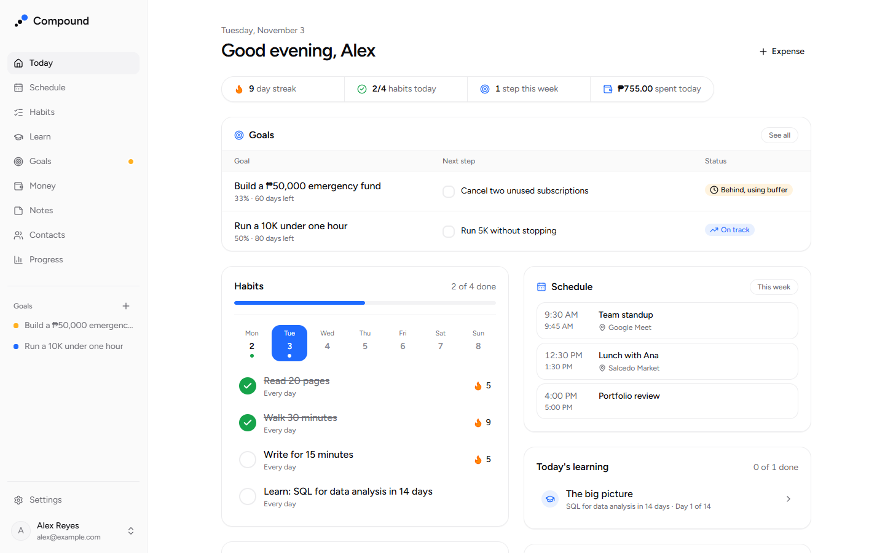
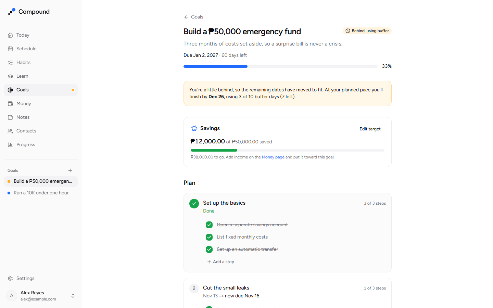
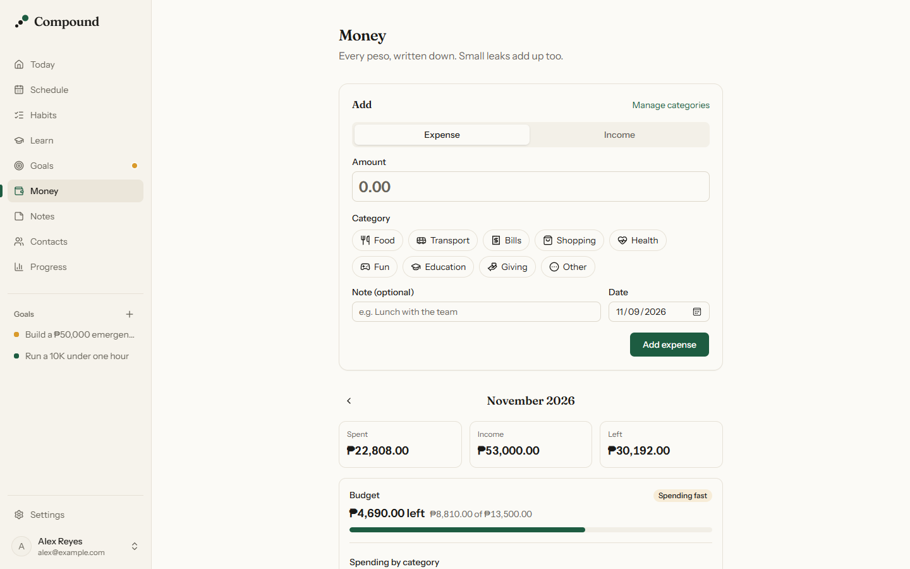
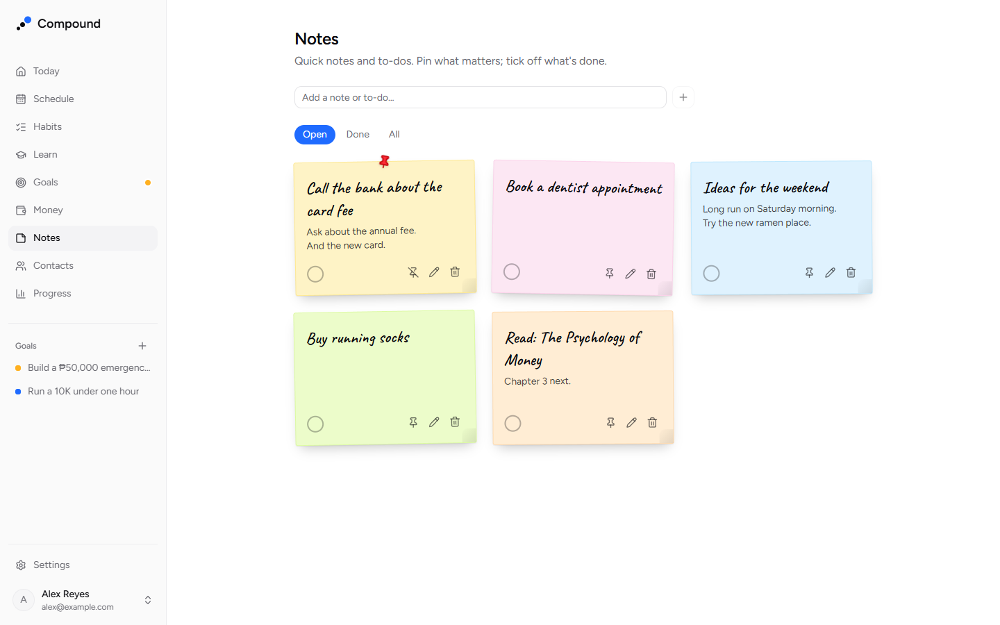
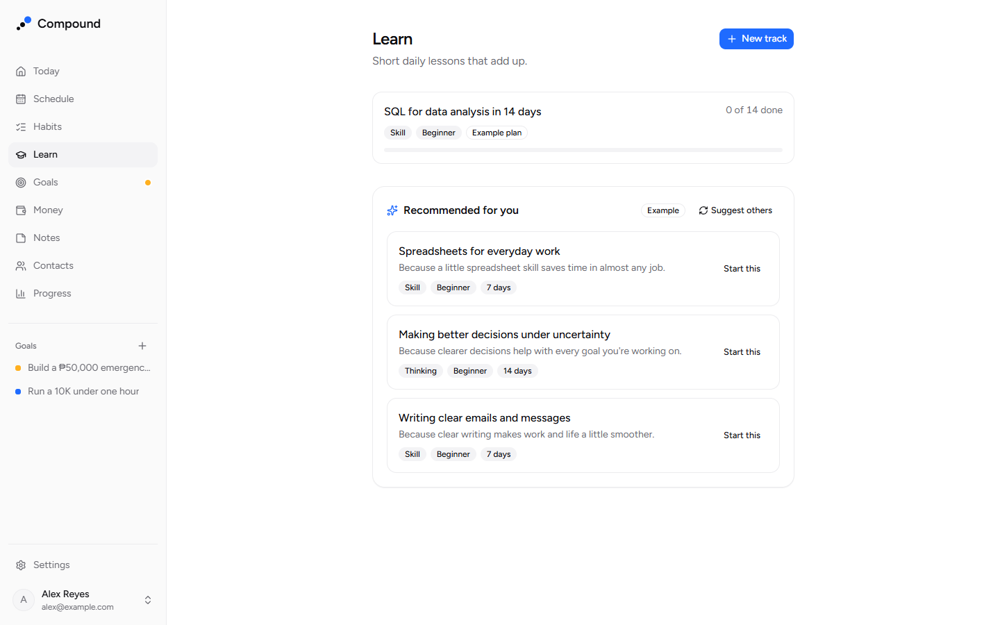
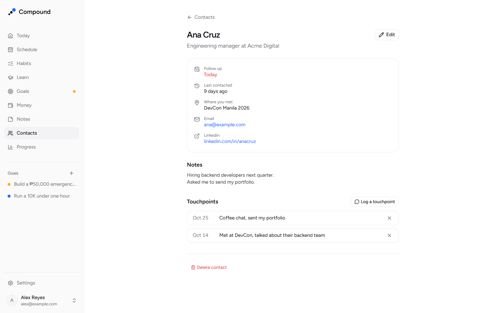

# Compound: small daily steps, compounding growth

**Live:** [compound-nine-chi.vercel.app](https://compound-nine-chi.vercel.app) · **Code:** [github.com/DanielZyrick/Compound](https://github.com/DanielZyrick/Compound)

Compound is a web app for getting 1% better every day. In one place, you check off your habits, follow a short AI-generated learning track picked for you, take the next step on your goals, follow up with the people in your network, see today's calendar, jot down a quick to-do, and write down what you spent. I designed, built, tested and deployed it on my own as a portfolio project, in small steps that each shipped to production.

## The problem

Self-improvement usually lives in four apps: a habit tracker, a course platform, a to-do list for goals, and a budgeting app. Each one shows a slice, so it's hard to see whether the small daily steps are adding up. I wanted a single **Today** page that answers one question: *what are the few things I should do today?* Then a Progress page shows how those days compound.

## What it does

**Learning & Habits.** You create habits with a weekly schedule and check them off on Today. Streaks and a 30-day history show your consistency. Forgot to tick the gym yesterday? The Habits page lets you fill in any day from the last week when the habit was due, with a nudge to be honest. You can start a learning track by describing what you want to learn, such as "SQL for data analysis". Claude drafts a 7, 14 or 30-day plan, and each day opens a short lesson with exercises. You go at your own pace: a day opens on its date, or as soon as you finish the one before, so a 30-day track can take a week. Multiple-choice answers are graded on the server. Written answers get AI feedback and a better version. Reading tracks, such as a Bible plan, follow a fixed plan, link to a real translation, and keep a reflection journal. A principle of the day adds one idea to think about.

**Goals.** You describe a goal, why it matters and a deadline. The AI drafts milestones and steps, which you can edit before and after saving, plus a short execution guide. Each goal keeps buffer days before its deadline for setbacks. As you tick off steps, the app works out whether you're on track, behind and using buffer, or at risk. If you slip, the remaining dates move to fit. Goals that need attention get a dot in the navigation.

**Money.** You record an expense or income in a few taps: amount, category, done. The form stays open for the next one. A month view shows spent, income and what's left, spending by category, and a list grouped by day. You can manage your own categories. Income can go toward a goal's savings target, so the money module and the goals module tell one story.

**Notes.** Quick notes and to-dos live on a board of sticky notes. You add one from Today in a second, tick it off, pin what matters, and give it a paper colour. Titles are in a handwriting font, and each note sits at a slight angle, fixed per note so the board never jumps around.

**About you and recommended tracks.** A short, optional profile asks what you do, what you want to get better at, what you already know and how much time you have a day. Claude can fill it in from a resume PDF for you to check; the file is never stored and contact details are left out. Everything the AI writes for you (principles, track plans, goal plans) uses it, and the Learn page suggests three tracks with a reason each, such as *"Because you already know JavaScript and want to get better at backend development."* One tap opens the new-track form already filled in.

**Contacts.** For the people you meet for work: where you met, a follow-up date, and the goal they can help with. You log touchpoints ("Coffee chat, sent my portfolio") and pick when to follow up next. Today shows who's due, with Done and Snooze, and each goal lists the people who can help with it.

**Schedule.** You can connect Google Calendar, read-only. Today shows today's events with the next one highlighted, and a Schedule page shows the week ahead, all in your timezone.

**Sign-in.** You sign in with Google or GitHub. Accounts are matched by email, so both open the same account, and sign-in only accepts an address the provider has verified. A public privacy page explains what's stored.

## Key technical decisions

**AI output is untrusted input.** Every Claude call runs on the server only, and the API key never reaches the browser. Each response must be JSON that passes a Zod schema. If it doesn't, the call retries once, then shows a clear error. Generated lessons and principles are cached in Postgres, so they are never paid for twice. Every call is logged, with token counts, and counts toward a daily limit of 20 per user. Model names come from environment variables, so switching models doesn't need a code change. Two rules exist because the content matters: the AI never writes scripture text, and the user's own focus description is only used for examples, so it can't pull a plan off-topic.

**A demo mode that makes the app free to run.** With no API key, or with `AI_DEMO_MODE=1`, the app uses clearly labelled example content instead of calling Claude. Anyone can clone and run the full app without paying, and the end-to-end tests never spend credits or flake on nondeterministic output.

**The goal schedule is pure functions, never stored.** Status, adjusted dates and buffer use are computed from the plan and the steps you've ticked, in [`lib/goals/schedule.ts`](../compound/lib/goals/schedule.ts). Nothing about the schedule is saved, so it can't drift out of sync, and it's easy to unit test. Testing caught a real design flaw. I first derived your pace from the current deadline, so extending a deadline *slowed* the expected pace, and an at-risk goal stayed at risk. The fix was to measure pace against the original plan, so extra time really is extra room. A test now pins that behaviour.

**Money in integer cents.** Amounts are parsed from what you type ("1,250.50") into whole cents and stored as integers, never floats, so totals never pick up rounding errors. Formatting uses `Intl` with the currency you pick in Settings. The database enforces the rest: positive amounts, a valid currency code, and unique category names regardless of capitalisation. Categories are archived instead of deleted, so old transactions keep their history.

**Google Calendar without storing anyone's calendar.** I used Google's OAuth and REST API directly with `fetch` rather than adding an SDK. Access is read-only. A random, single-use state value in a short-lived cookie ties Google's answer to the request that started it. The tokens are encrypted with AES-256-GCM under a key that lives only in the environment, so a database copy alone can't read anyone's calendar. Events are fetched when you look and never saved, never sent to the AI, and a slow or broken connection shows a short message instead of breaking Today. Placing events on the right day meant working out local midnight in any timezone, including on daylight-saving days, which unit tests pin down.

**A resume is input, not storage.** The resume PDF goes to Claude once as a document, and the answers come back through the same schema checks as every other AI output. The server checks the file's first bytes, not just its name, and limits it to 4 MB to stay under Vercel's request size. Nothing is saved until you press Save.

**Safety around production data.** Development runs on a separate Neon database branch. The migration runner prints which host it's about to touch. A new migration is applied to production *before* the code that needs it is pushed, so the live site never runs code against a schema it doesn't have yet. The end-to-end tests refuse to run unless the database host matches an allowed dev host.

**Fast pages with Next.js 16.** With Cache Components, each page prerenders a static shell, and anything that reads the session streams in inside `<Suspense>`. Auth is checked in a data access layer that every page and server action calls before touching data, not only in middleware. Server actions validate input with Zod and check ownership in the query itself.

## Testing

- **279 unit tests** (Vitest) cover the logic that's easy to get subtly wrong: streaks, timezone-aware dates, which days can be filled in, which lesson days are open, the goal schedule, parsing and formatting money, verified sign-in emails, follow-up dates, token encryption, the calendar connect checks, placing events on days, and validating AI output.
- **28 end-to-end flows** (Playwright) run on both a desktop browser and a phone viewport. They cover onboarding, habits and filling in a missed day, lessons at your own pace, a reading, creating and editing goals, falling behind and catching up, recording money, managing categories, saving toward a goal, notes, About you and a resume, recommended tracks, contacts and follow-ups, and connecting a calendar. They sign in as a dedicated test user, run with a demo AI and a demo calendar, and clean up afterwards.

## What I learned

- **Write the test the way a person uses the app.** Several "bugs" turned out to be test problems: clicking a button before React had hydrated it, or a check finding the previous page still hidden in the DOM after navigation. Waiting for the page to be interactive, and asserting what's *visible*, made the suite reliable.
- **Round trips add up.** Creating a goal first did one insert per milestone and per step, about ten trips to the database, and it was slow enough to time out tests. Batching the inserts fixed it.
- **Guardrails are cheaper than accidents.** Early on, a misconfigured environment variable pointed a migration at production. Nothing was lost, but it led directly to printing the host before every migration and to the e2e guard.
- **Ship the schema first, every time.** Once, I pushed a feature before running its migration on production, and the Today page broke until the migration ran. Now every new migration runs on production before its code is pushed.
- **Compare times from one clock.** Recommended tracks were regenerating on every reload. The profile's "last changed" time came from the database's clock and the suggestions' "made at" time from the app server's, and the two were a little apart. An end-to-end test caught it; both now use the database's clock.
- **AI features are mostly not about the prompt.** Schemas, retries, caching, limits, logging and a demo mode took more work than the prompts, and they're what make the AI parts dependable.

## What's next

Monthly budgets per category, due dates on to-dos that show on Today and in Schedule, email reminders, a custom domain so Google can verify the Calendar connection, and evals to measure the quality of AI feedback and suggestions.

## Stack

Next.js 16 (App Router, Cache Components) · React 19 · TypeScript (strict) · PostgreSQL on Neon · Kysely · Auth.js (Google, GitHub) · Zod · Tailwind CSS 4 · shadcn/ui · Claude API · Vitest · Playwright · Vercel
